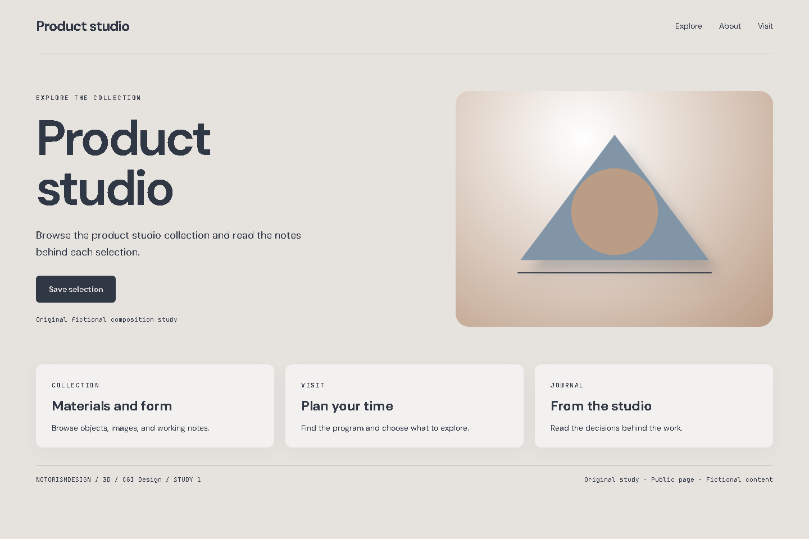
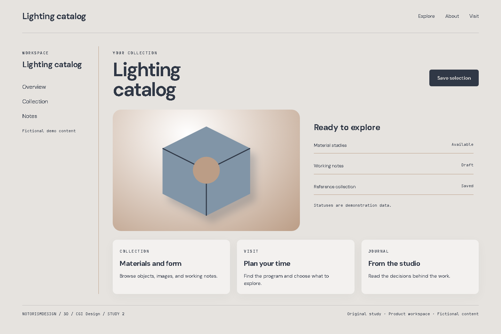
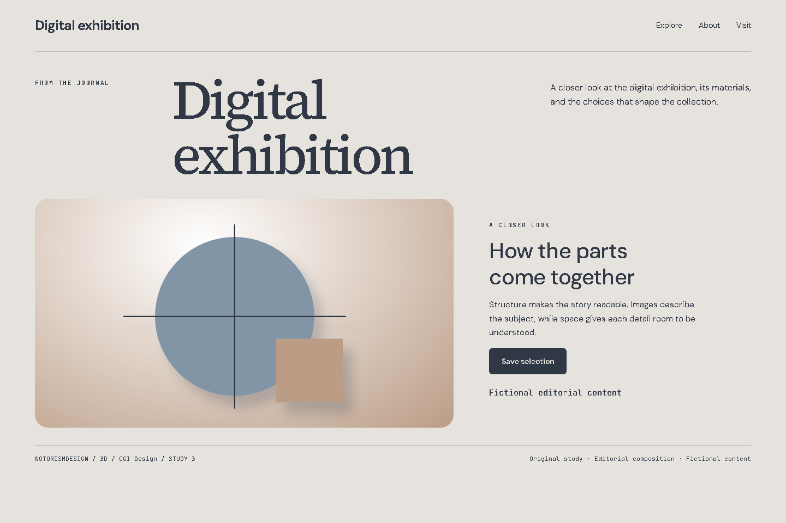

# 3D / CGI Design

## What this label means

Computer-generated imagery involves modeling, materials, and lighting. The Web can show static renders or interactive scenes.

Category: Texture and graphic techniques. This label describes a graphic treatment that can support different identities.

## Defining mechanics

- Volume.
- coherent lighting.
- materials.
- camera.
- static alternative.

## Suitable subjects

Product studio, Lighting catalog, Digital exhibition are starting contexts for analysis. Choose this language only when the audience, content, and primary task support it. Explain which mechanic belongs to the subject.

## Implementation decisions

Use hierarchy and composition before decoration. Resolve the actual product’s existing tokens first. The study palette is #e6e3df, #303846, #8195a7, #bb9d86. Its roles are canvas, foreground, accent, and supporting surface. Measure actual contrast; the sample palette is not an accessibility certificate.

Keep reading text clear while applying the distinctive treatment to the appropriate visual plane. Match image material and icon weight to the direction. Preserve recognizable actions, semantic markup, focus, and responsive reading order. Move the layout to narrow screens intentionally rather than shrinking it.

A simplified code-native volume and lighting study. It is not a photograph or a production CGI render.

## Main failure mode

Presenting a basic CSS object as hyperrealistic CGI. Other risks must be judged in the current brief rather than added as universal style bans.

## Three examples to analyze

### 1. Product studio: Public page

[Open the working HTML](../../../images/3d-cgi-design/example-01.html). A simplified code-native volume and lighting study. It is not a photograph or a production CGI render.

Hierarchy: A subject-specific headline, one action, then related collections. Composition: A public opening with a focal visual and supporting content. Material: Volume; coherent lighting; materials; camera; static alternative.

Inspect the actual image. Record one visual observation, one transferable choice, and one limitation in the project artifact. Do not merely copy this description into the analysis.

### 2. Lighting catalog: Product workspace

[Open the working HTML](../../../images/3d-cgi-design/example-02.html). A simplified code-native volume and lighting study. It is not a photograph or a production CGI render.

Hierarchy: Navigation, working context, object statuses, and object-level action. Composition: A workspace with sidebar, preview, list, and repeated units. Material: Volume; coherent lighting; materials; camera; static alternative.

Inspect the actual image. Record one visual observation, one transferable choice, and one limitation in the project artifact. Do not merely copy this description into the analysis.

### 3. Digital exhibition: Editorial composition

[Open the working HTML](../../../images/3d-cgi-design/example-03.html). A simplified code-native volume and lighting study. It is not a photograph or a production CGI render.

Hierarchy: Title-image relationship, captioned context, and reading rhythm. Composition: An editorial opening with a large title and a composed image-text spread. Material: Volume; coherent lighting; materials; camera; static alternative.

Inspect the actual image. Record one visual observation, one transferable choice, and one limitation in the project artifact. Do not merely copy this description into the analysis.

## History and evidence

The origin paragraph is a concise contextual introduction. Community labels may have disputed boundaries and no known founder. Distinguish a style’s history from the history of a curatorial archive. Do not invent dates or attribute modern interface techniques to an unrelated historical artist. Verify detailed historical claims against the linked primary material when the deliverable depends on them.

- [MDN, CSS reference](https://developer.mozilla.org/en-US/docs/Web/CSS/Reference): Current implementation of surfaces and effects. Not evidence of historical authorship.
- [Steve Krug, Don’t Make Me Think, Revisited (2014)](https://sensible.com/dont-make-me-think/): Scanning, familiar conventions, and usability testing. Original synthesis, not a transcription of the book.
- [Don Norman, The Design of Everyday Things, revised edition (2013)](https://jnd.org/books/the-design-of-everyday-things-revised-and-expanded-edition/): Signifiers, feedback, constraints, and conceptual models. Interaction foundations, not a style catalog.
- [W3C, WCAG 2.2 Quick Reference](https://www.w3.org/WAI/WCAG22/quickref/): Contrast, keyboard access, focus, text alternatives, and interaction targets.

Book references inform usability and interaction. They do not establish this style’s origin. For implementation maintainability, see [the bibliography](../../research/bibliography.md).
