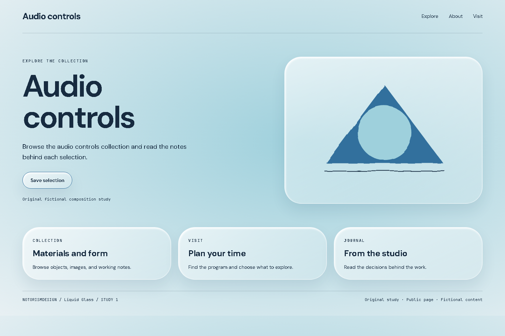
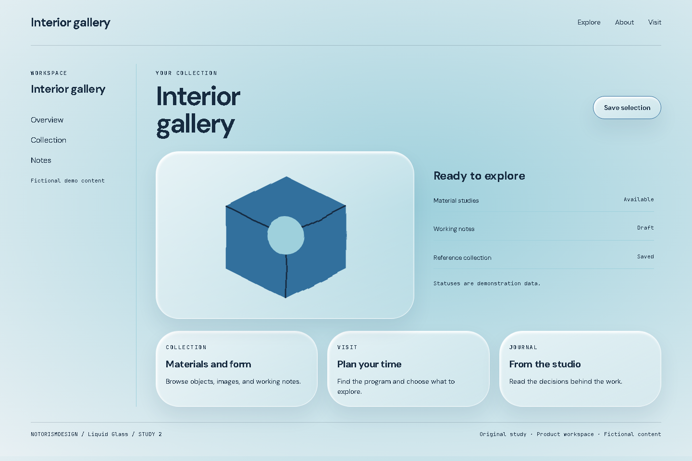
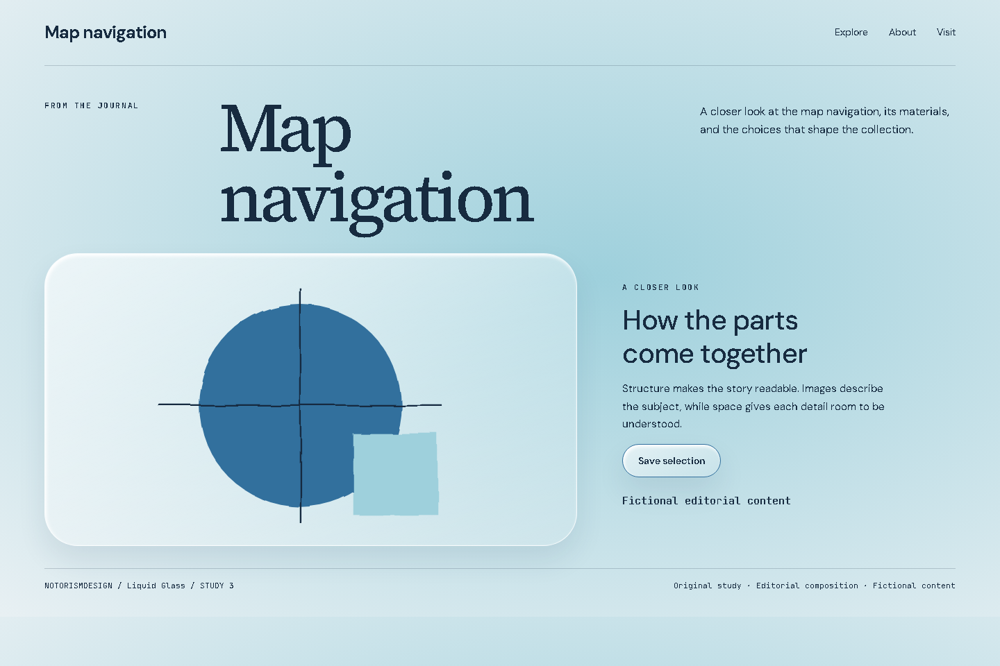

# Liquid Glass

## What this label means

Apple introduced the named Liquid Glass language in June 2025. Refraction and dynamic adaptation exceed a simple backdrop-filter layer.

Category: Interface and materials. This entry supplies a visual vocabulary, not permission to change the user’s product or scope.

## Defining mechanics

- Glassy contours.
- curved highlights.
- subtle distortion.
- controls over changing planes.

## Suitable subjects

Audio controls, Interior gallery, Map navigation are starting contexts for analysis. Choose this language only when the audience, content, and primary task support it. Explain which mechanic belongs to the subject.

## Implementation decisions

Use hierarchy and composition before decoration. Resolve the actual product’s existing tokens first. The study palette is #e8f0f3, #172b40, #316f9d, #9ed0dc. Its roles are canvas, foreground, accent, and supporting surface. Measure actual contrast; the sample palette is not an accessibility certificate.

Keep reading text clear while applying the distinctive treatment to the appropriate visual plane. Match image material and icon weight to the direction. Preserve recognizable actions, semantic markup, focus, and responsive reading order. Move the layout to narrow screens intentionally rather than shrinking it.

A CSS and SVG approximation of a glass treatment, not a reproduction of Apple’s native optical material.

## Main failure mode

Promising physical refraction using transparency alone. Other risks must be judged in the current brief rather than added as universal style bans.

## Three examples to analyze

### 1. Audio controls: Public page

[Open the working HTML](../../../images/liquid-glass/example-01.html). A CSS and SVG approximation of a glass treatment, not a reproduction of Apple’s native optical material.

Hierarchy: A subject-specific headline, one action, then related collections. Composition: A public opening with a focal visual and supporting content. Material: Glassy contours; curved highlights; subtle distortion; controls over changing planes.

Inspect the actual image. Record one visual observation, one transferable choice, and one limitation in the project artifact. Do not merely copy this description into the analysis.

### 2. Interior gallery: Product workspace

[Open the working HTML](../../../images/liquid-glass/example-02.html). A CSS and SVG approximation of a glass treatment, not a reproduction of Apple’s native optical material.

Hierarchy: Navigation, working context, object statuses, and object-level action. Composition: A workspace with sidebar, preview, list, and repeated units. Material: Glassy contours; curved highlights; subtle distortion; controls over changing planes.

Inspect the actual image. Record one visual observation, one transferable choice, and one limitation in the project artifact. Do not merely copy this description into the analysis.

### 3. Map navigation: Editorial composition

[Open the working HTML](../../../images/liquid-glass/example-03.html). A CSS and SVG approximation of a glass treatment, not a reproduction of Apple’s native optical material.

Hierarchy: Title-image relationship, captioned context, and reading rhythm. Composition: An editorial opening with a large title and a composed image-text spread. Material: Glassy contours; curved highlights; subtle distortion; controls over changing planes.

Inspect the actual image. Record one visual observation, one transferable choice, and one limitation in the project artifact. Do not merely copy this description into the analysis.

## History and evidence

The origin paragraph is a concise contextual introduction. Community labels may have disputed boundaries and no known founder. Distinguish a style’s history from the history of a curatorial archive. Do not invent dates or attribute modern interface techniques to an unrelated historical artist. Verify detailed historical claims against the linked primary material when the deliverable depends on them.

- [Apple, Liquid Glass introduction, June 9, 2025](https://www.apple.com/newsroom/2025/06/apple-introduces-a-delightful-and-elegant-new-software-design/): Origin of the named Liquid Glass language. A CSS approximation does not reproduce the complete native optical material.
- [Steve Krug, Don’t Make Me Think, Revisited (2014)](https://sensible.com/dont-make-me-think/): Scanning, familiar conventions, and usability testing. Original synthesis, not a transcription of the book.
- [Don Norman, The Design of Everyday Things, revised edition (2013)](https://jnd.org/books/the-design-of-everyday-things-revised-and-expanded-edition/): Signifiers, feedback, constraints, and conceptual models. Interaction foundations, not a style catalog.
- [W3C, WCAG 2.2 Quick Reference](https://www.w3.org/WAI/WCAG22/quickref/): Contrast, keyboard access, focus, text alternatives, and interaction targets.

Book references inform usability and interaction. They do not establish this style’s origin. For implementation maintainability, see [the bibliography](../../research/bibliography.md).
