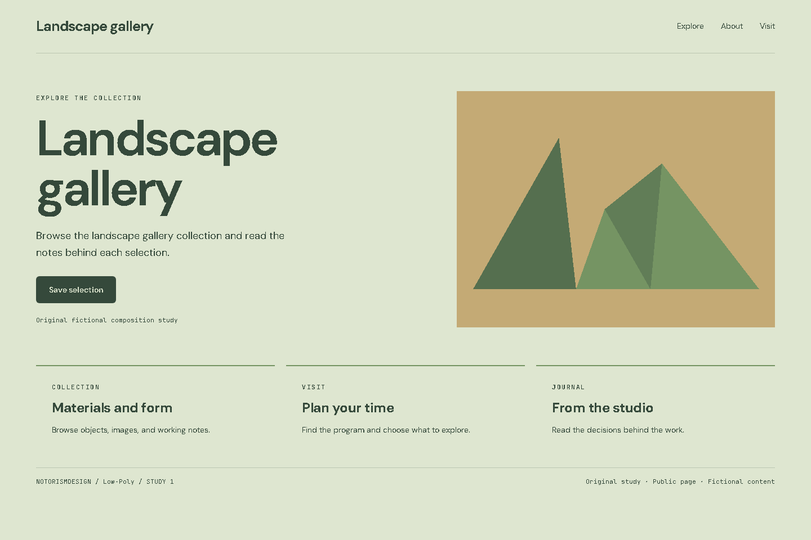
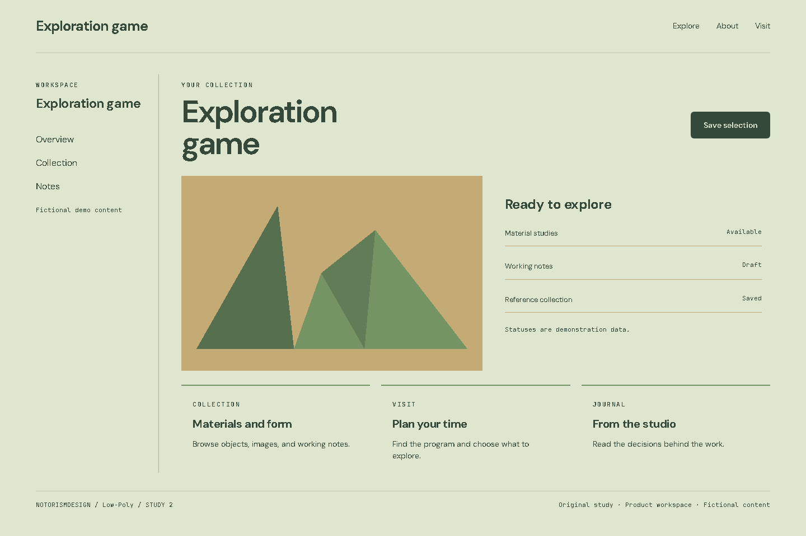
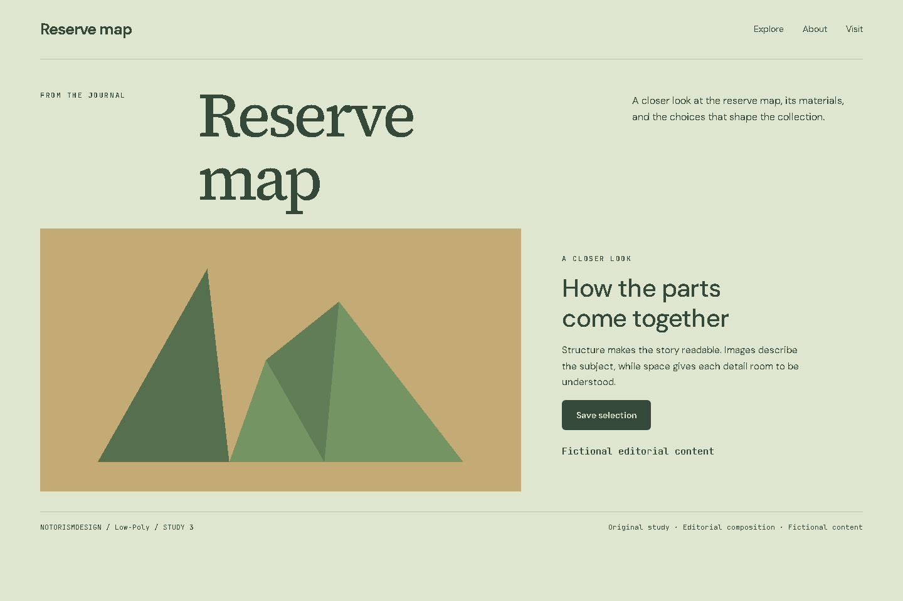

# Low-Poly

## What this label means

Representation through few-polygon meshes, initially related to rendering limits and later adopted as an authored language.

Category: Texture and graphic techniques. This label describes a graphic treatment that can support different identities.

## Defining mechanics

- Large faces.
- plane-based lighting.
- silhouette.
- coherent palette.
- simplified volume.

## Suitable subjects

Landscape gallery, Exploration game, Reserve map are starting contexts for analysis. Choose this language only when the audience, content, and primary task support it. Explain which mechanic belongs to the subject.

## Implementation decisions

Use hierarchy and composition before decoration. Resolve the actual product’s existing tokens first. The study palette is #dee6d0, #35493b, #759463, #c4aa75. Its roles are canvas, foreground, accent, and supporting surface. Measure actual contrast; the sample palette is not an accessibility certificate.

Keep reading text clear while applying the distinctive treatment to the appropriate visual plane. Match image material and icon weight to the direction. Preserve recognizable actions, semantic markup, focus, and responsive reading order. Move the layout to narrow screens intentionally rather than shrinking it.

A simplified original composition study, not a historical specimen or a real-client website screenshot.

## Main failure mode

Calling any decorative triangle a low-poly model. Other risks must be judged in the current brief rather than added as universal style bans.

## Three examples to analyze

### 1. Landscape gallery: Public page

[Open the working HTML](../../../images/low-poly/example-01.html). A simplified original composition study, not a historical specimen or a real-client website screenshot.

Hierarchy: A subject-specific headline, one action, then related collections. Composition: A public opening with a focal visual and supporting content. Material: Large faces; plane-based lighting; silhouette; coherent palette; simplified volume.

Inspect the actual image. Record one visual observation, one transferable choice, and one limitation in the project artifact. Do not merely copy this description into the analysis.

### 2. Exploration game: Product workspace

[Open the working HTML](../../../images/low-poly/example-02.html). A simplified original composition study, not a historical specimen or a real-client website screenshot.

Hierarchy: Navigation, working context, object statuses, and object-level action. Composition: A workspace with sidebar, preview, list, and repeated units. Material: Large faces; plane-based lighting; silhouette; coherent palette; simplified volume.

Inspect the actual image. Record one visual observation, one transferable choice, and one limitation in the project artifact. Do not merely copy this description into the analysis.

### 3. Reserve map: Editorial composition

[Open the working HTML](../../../images/low-poly/example-03.html). A simplified original composition study, not a historical specimen or a real-client website screenshot.

Hierarchy: Title-image relationship, captioned context, and reading rhythm. Composition: An editorial opening with a large title and a composed image-text spread. Material: Large faces; plane-based lighting; silhouette; coherent palette; simplified volume.

Inspect the actual image. Record one visual observation, one transferable choice, and one limitation in the project artifact. Do not merely copy this description into the analysis.

## History and evidence

The origin paragraph is a concise contextual introduction. Community labels may have disputed boundaries and no known founder. Distinguish a style’s history from the history of a curatorial archive. Do not invent dates or attribute modern interface techniques to an unrelated historical artist. Verify detailed historical claims against the linked primary material when the deliverable depends on them.

- [MDN, CSS reference](https://developer.mozilla.org/en-US/docs/Web/CSS/Reference): Current implementation of surfaces and effects. Not evidence of historical authorship.
- [Steve Krug, Don’t Make Me Think, Revisited (2014)](https://sensible.com/dont-make-me-think/): Scanning, familiar conventions, and usability testing. Original synthesis, not a transcription of the book.
- [Don Norman, The Design of Everyday Things, revised edition (2013)](https://jnd.org/books/the-design-of-everyday-things-revised-and-expanded-edition/): Signifiers, feedback, constraints, and conceptual models. Interaction foundations, not a style catalog.
- [W3C, WCAG 2.2 Quick Reference](https://www.w3.org/WAI/WCAG22/quickref/): Contrast, keyboard access, focus, text alternatives, and interaction targets.

Book references inform usability and interaction. They do not establish this style’s origin. For implementation maintainability, see [the bibliography](../../research/bibliography.md).
