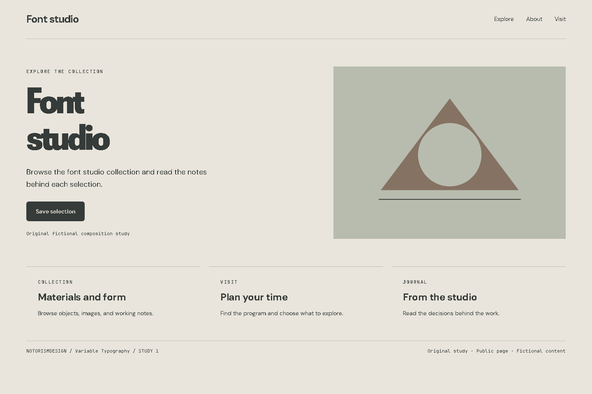
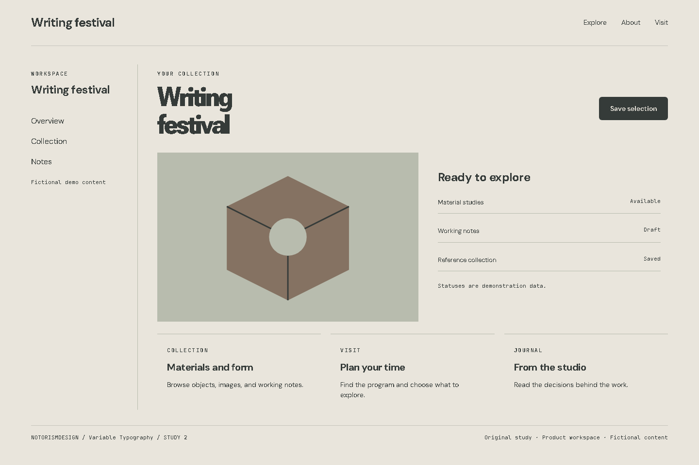
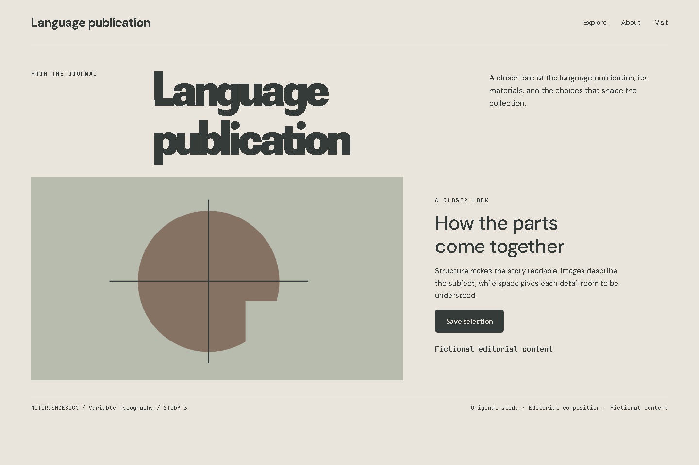

# Variable Typography

## What this label means

Variable fonts encode multiple axes in one file. OpenType specifications and web support enable continuous weight and width control.

Category: Interaction and motion. This label describes behavior. A still image cannot prove that behavior.

## Defining mechanics

- Existing axes.
- legible interpolation.
- type roles.
- limits.
- verified fonts.

## Suitable subjects

Font studio, Writing festival, Language publication are starting contexts for analysis. Choose this language only when the audience, content, and primary task support it. Explain which mechanic belongs to the subject.

## Implementation decisions

Use hierarchy and composition before decoration. Resolve the actual product’s existing tokens first. The study palette is #e9e5dc, #353b39, #857262, #b8bcae. Its roles are canvas, foreground, accent, and supporting surface. Measure actual contrast; the sample palette is not an accessibility certificate.

Keep reading text clear while applying the distinctive treatment to the appropriate visual plane. Match image material and icon weight to the direction. Preserve recognizable actions, semantic markup, focus, and responsive reading order. Move the layout to narrow screens intentionally rather than shrinking it.

Uses a bundled variable font when present; verify actual loaded axes rather than inferring them from a still.

## Main failure mode

Applying font-variation-settings to a static font or endlessly animating body text. Other risks must be judged in the current brief rather than added as universal style bans.

## Three examples to analyze

### 1. Font studio: Public page

[Open the working HTML](../../../images/variable-typography/example-01.html). Uses a bundled variable font when present; verify actual loaded axes rather than inferring them from a still.

Hierarchy: A subject-specific headline, one action, then related collections. Composition: A public opening with a focal visual and supporting content. Material: Existing axes; legible interpolation; type roles; limits; verified fonts.

Inspect the actual image. Record one visual observation, one transferable choice, and one limitation in the project artifact. Do not merely copy this description into the analysis.

### 2. Writing festival: Product workspace

[Open the working HTML](../../../images/variable-typography/example-02.html). Uses a bundled variable font when present; verify actual loaded axes rather than inferring them from a still.

Hierarchy: Navigation, working context, object statuses, and object-level action. Composition: A workspace with sidebar, preview, list, and repeated units. Material: Existing axes; legible interpolation; type roles; limits; verified fonts.

Inspect the actual image. Record one visual observation, one transferable choice, and one limitation in the project artifact. Do not merely copy this description into the analysis.

### 3. Language publication: Editorial composition

[Open the working HTML](../../../images/variable-typography/example-03.html). Uses a bundled variable font when present; verify actual loaded axes rather than inferring them from a still.

Hierarchy: Title-image relationship, captioned context, and reading rhythm. Composition: An editorial opening with a large title and a composed image-text spread. Material: Existing axes; legible interpolation; type roles; limits; verified fonts.

Inspect the actual image. Record one visual observation, one transferable choice, and one limitation in the project artifact. Do not merely copy this description into the analysis.

## History and evidence

The origin paragraph is a concise contextual introduction. Community labels may have disputed boundaries and no known founder. Distinguish a style’s history from the history of a curatorial archive. Do not invent dates or attribute modern interface techniques to an unrelated historical artist. Verify detailed historical claims against the linked primary material when the deliverable depends on them.

- [MDN, Variable fonts guide](https://developer.mozilla.org/en-US/docs/Web/CSS/CSS_fonts/Variable_fonts_guide): Actual variable font axes and how to use them.
- [Steve Krug, Don’t Make Me Think, Revisited (2014)](https://sensible.com/dont-make-me-think/): Scanning, familiar conventions, and usability testing. Original synthesis, not a transcription of the book.
- [Don Norman, The Design of Everyday Things, revised edition (2013)](https://jnd.org/books/the-design-of-everyday-things-revised-and-expanded-edition/): Signifiers, feedback, constraints, and conceptual models. Interaction foundations, not a style catalog.
- [W3C, WCAG 2.2 Quick Reference](https://www.w3.org/WAI/WCAG22/quickref/): Contrast, keyboard access, focus, text alternatives, and interaction targets.

Book references inform usability and interaction. They do not establish this style’s origin. For implementation maintainability, see [the bibliography](../../research/bibliography.md).
